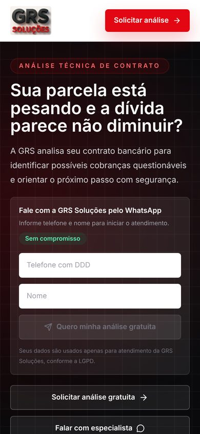

# GRS Soluções — Landing page de captação

Landing page da GRS Soluções para captar leads de análise revisional de juros (campanhas do Google Ads).
GRS Soluções landing page that captures leads for interest-rate contract reviews (Google Ads campaigns).

[🇧🇷 Português](#-português) · [🇺🇸 English](#-english)

<p align="center">
  
  
</p>

---

## 🇧🇷 Português

Landing page em Next.js App Router para captacao de leads de analise revisional de juros.

### Rodar localmente

```bash
npm install
npm run dev
```

Crie um arquivo `.env.local` a partir de `.env.example`:

```bash
GOOGLE_SHEETS_WEBHOOK_URL=
GOOGLE_SHEETS_WEBHOOK_SECRET=
NEXT_PUBLIC_WHATSAPP_NUMBER=
```

### Google Sheets

Os leads sao enviados para a rota server-side `POST /api/leads`, que valida os dados com Zod e repassa a solicitacao para um Web App do Google Apps Script.

Veja o passo a passo completo em `GOOGLE_SHEETS_SETUP.md`.

1. Abra a planilha de leads no Google Sheets.
2. Va em `Extensoes > Apps Script`.
3. Cole o conteudo de `google-apps-script/Code.gs`.
4. Configure as propriedades do script:
   - `SPREADSHEET_ID`
   - `SHEET_NAME`
   - `WEBHOOK_SECRET`
5. Publique como Web App e copie a URL `/exec`.
6. Configure essa URL em `GOOGLE_SHEETS_WEBHOOK_URL`.
7. Use o mesmo segredo em `GOOGLE_SHEETS_WEBHOOK_SECRET`.

### Tracking

O carregamento de GTM, GA4 e Meta Pixel fica em `src/app/layout.tsx`. Mantenha IDs publicos em variaveis `NEXT_PUBLIC_*`.

---

## 🇺🇸 English

A Next.js (App Router) landing page that captures leads for interest-rate contract reviews.

**Highlights:** hero with a quick form, pain points, how it works, contract types, social proof, FAQ, floating WhatsApp button, thank-you page (`/obrigado`), privacy policy and terms of use. Forms are validated with React Hook Form + Zod.

### Tech stack

Next.js 16 · React 19 · TypeScript · Tailwind CSS 4 · React Hook Form · Zod · Google Apps Script

### Running locally

```bash
npm install
npm run dev
```

Create a `.env.local` file from `.env.example`:

```bash
GOOGLE_SHEETS_WEBHOOK_URL=
GOOGLE_SHEETS_WEBHOOK_SECRET=
NEXT_PUBLIC_WHATSAPP_NUMBER=
```

### Google Sheets

Leads go to the server-side route `POST /api/leads`. It validates them with Zod and forwards them to a Google Apps Script Web App. The full walkthrough is in `GOOGLE_SHEETS_SETUP.md`.

1. Open the leads spreadsheet in Google Sheets.
2. Go to `Extensions > Apps Script`.
3. Paste the contents of `google-apps-script/Code.gs`.
4. Set the script properties `SPREADSHEET_ID`, `SHEET_NAME` and `WEBHOOK_SECRET`.
5. Deploy it as a Web App and copy the `/exec` URL.
6. Put that URL in `GOOGLE_SHEETS_WEBHOOK_URL`.
7. Use the same secret in `GOOGLE_SHEETS_WEBHOOK_SECRET`.

### Tracking

GTM, GA4 and Meta Pixel are loaded in `src/app/layout.tsx`. Keep public IDs in `NEXT_PUBLIC_*` variables. Campaign and conversion setup notes are in `CAMPANHA_GOOGLE_ADS.md` and `SETUP_CONVERSAO.md`.
